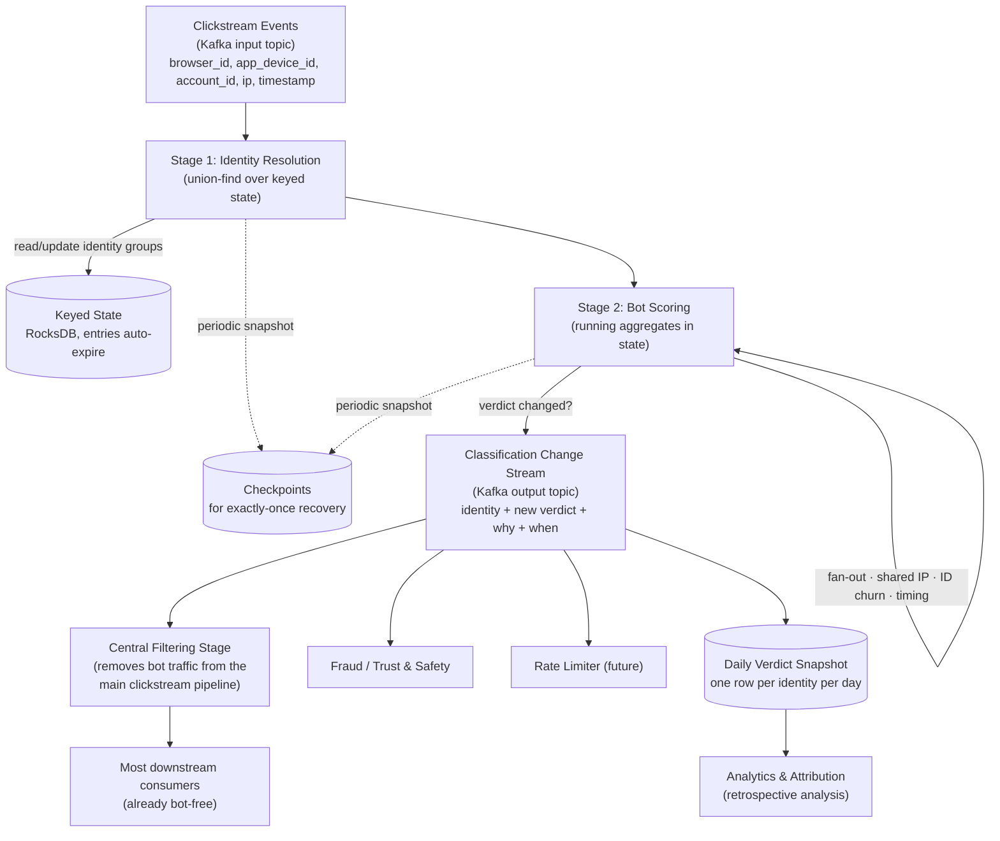

# Real-Time Identity Resolution & Bot Detection — Architecture & Data Model

## The One-Paragraph Version

A Flink job reads clickstream events from Kafka. Stage one groups identifiers that appear together into a single identity. Stage two scores how bot-like that identity is behaving, from running counters held in state. It holds a current verdict per identity and publishes a record **only when that verdict changes**, so the output is a small changelog rather than a copy of the firehose. The whole thing is built so that if a machine dies mid-stream, nothing is lost or double-counted.

## Key Terms

| Term | What it means |
|---|---|
| Flink | The stream processing engine this runs on. Handles events as they arrive rather than in nightly batches. |
| Kafka | The message queue events flow through — topics in, topics out. |
| Operator | One processing step inside the job. Ours has two: identity resolution, then bot scoring. |
| Keyed state | Memory the job keeps per key — here, per identity. When an event for identity X arrives, Flink hands the operator exactly X's stored data to read and update. |
| RocksDB | An on-disk key-value store Flink can use for that state, so it can exceed available memory. |
| TaskManager | A Flink worker process. A job spans several; killing one is how we test recovery. |
| Checkpoint | A periodic snapshot of all job state. After a crash, the job restarts from the last one. |
| Exactly-once | Each input event affects the output exactly one time, even across a crash. Not "at least once" (duplicates), not "at most once" (loss). |
| Event time | Ordering by when something happened, not when it reached us. |
| Watermark | A marker flowing through the stream meaning "we believe we've seen everything up to time T." Here it governs when an old activity bucket can be retired, not when a score is emitted. |
| Union-find | An algorithm for merging groups. Each group has one member designated its representative; merging points one representative at the other. Asking "are these two in the same group?" means following pointers up to each one's representative. |

## The Identifiers We Work With

This drives every design decision downstream, so it comes first.

| Identifier | Backed by | Scope | Survives a browser-data clear? |
|---|---|---|---|
| **Browser ID** | A long-lived cookie, typically years, often stored redundantly across paired cookies so a partial clear regenerates it | One browser | Only partially — a deliberate full clear resets it |
| **App device ID** | Operating-system device identifier, no cookies involved | One device, **app traffic only** | Yes, entirely unaffected |
| **Account ID** | Login | One person | Yes |

**The critical point: on web there is no hardware identifier.** Clickstream schemas commonly label the long-lived browser cookie a "device ID," but it identifies a browser, not a machine. Two browsers on one laptop yield two of them. This means on web, "browser ID" and "device ID" are *one signal, not two* — and treating them as independent corroboration would be double-counting.

### What this implies

**Only these merges carry information:**

| Merge edge | Fires on | Value |
|---|---|---|
| Browser ID ↔ account ID | Web login | The only way to join two browsers to one person |
| App device ID ↔ account ID | App login | Joins app activity to the person |
| **App device ID ↔ browser ID** | **App webview — both on one event** | Bridges app and web identity. The highest-value edge we get. |

**IP address is deliberately not a merge key** — see Example C.

## Architecture



## How It Works, Step by Step

### Stage 1 — Identity Resolution (runs on every event)

An event may carry a browser ID, sometimes an app device ID, sometimes an account ID. The fact that they arrived on the *same event* is the evidence they belong to one person. The operator looks up which group each currently belongs to; if they're in different groups, it merges them. Then it tags the event with the resulting identity and passes it on.

Merging is permanent and incremental — we never recompute the graph, we absorb evidence as it arrives. That's what makes it real-time.

#### What union-find buys us

It connects identifiers that were **never seen together**.

| Day | Seen on one event | What it tells us |
|---|---|---|
| Monday | laptop browser, alone | nothing yet |
| Tuesday | phone browser **+ account** | same person |
| Wednesday | laptop browser **+ account** | same person |

The laptop and the phone never appear on the same event — but both appear with the account, so all three are one traveler. Union-find is what chains that together automatically as each new pair arrives, rather than us rebuilding the picture from scratch.

Its two operations are its name: **union** merges two groups once we learn they're the same person, and **find** answers which group an identifier currently belongs to.

Each identifier stores only who it points at, plus the member list if it happens to be its group's representative. When two groups merge, the smaller one points at the larger, and the winner is chosen by a fixed rule (lexicographically smaller identifier) so that a replay after a crash reproduces exactly the same identities.

It is written directly against Flink state rather than taken from a library, because library implementations keep the whole structure in ordinary memory — which Flink would not include in checkpoints, so the entire identity graph would vanish on the first restart.

### Stage 2 — Bot Scoring (runs on every event)

Scoring maintains **running aggregates in keyed state** rather than waiting for windows to close. Every event reads the current aggregates, computes a score, attaches it to the event, and updates the state. This is what lets the score ride along with the event instead of arriving minutes later — see "Why running aggregates, not closed windows" below.

Four signals, two keyed by identity and two by IP address:

| Signal | Keyed by | What it tracks |
|---|---|---|
| **Fan-out** | identity | Running count of identifiers absorbed into this identity. Strong on app traffic, **weak on web** — Example B shows why. |
| **Click timing** | identity | Running mean and variance of gaps between events. Humans pause and vary; scripts are too fast or too regular. |
| **Shared IP address** | IP address | How many *separate* identities are active on this address. Catches bot farms whose identities never merged, because they never let identifiers co-occur on one event. |
| **New-identifier churn** | IP address | How many brand-new browser IDs first appear from this address per minute. The counter to cookie-rotating bots, and the main signal still working when fan-out fails. |

The two IP-keyed signals are maintained as **rolling one-minute buckets, keyed by event time** — keep the last N buckets, sum on read, drop the oldest. That gives a recent-activity view with bounded state and nothing to wait on, unlike a window that must close before it yields a number.

Buckets are event-time rather than arrival-time because clickstream arrives out of order, and an event that arrives late still belongs to the minute it actually happened. Watermarks decide when a bucket is old enough to retire — so event time and watermarks still govern state lifetime here, they just no longer gate when a score can be produced.

The four combine into one score, attached to the event alongside the individual values so each team can threshold on a specific signal rather than trusting our blend.

#### Why running aggregates, not closed windows

A closed window can only produce a verdict *after* it ends, which would delay every classification by the window length and produce a verdict on a fixed cadence whether or not anything changed.

Running aggregates let the job hold a **current verdict at all times**, re-evaluated on each event, and publish the moment that verdict actually moves.

**The honest trade-off:** a brand-new identity starts out looking unremarkable, because the evidence genuinely doesn't exist yet. The first few requests from a fresh scraper are classified human; once the IP-keyed signals accumulate, the verdict flips and a change record is published. The classification is therefore always "best knowledge now," and the changelog is the record of how it evolved.

**Late-arriving account IDs behave the same way.** An account ID appearing at checkout can merge two previously separate identities, which may change the merged identity's verdict — and that merge-driven flip is published like any other change.

## Worked Examples

### Example A — a real traveler

| Time | Event carries | Groups afterwards |
|---|---|---|
| Mon 9am | `B1` (laptop Chrome) | `{B1}` |
| Mon 8pm | `B2` (phone browser) | `{B1}`, `{B2}` — still two identities |
| Tue 8pm | `B2`, **`A1`** (logs in on phone) | `{B1}`, `{B2, A1}` |
| Wed 9am | `B1`, **`A1`** (logs in on laptop) | **`{B1, B2, A1}`** — merged |

The merge happens Wednesday because `A1` is already in one group while `B1` is in another, and one event touches both. Until then, treating them as two visitors was *correct given the evidence available*. Three identifiers over three days is unremarkable — no bot signal.

### Example B — a cookie-rotating scraper

A bot clearing browser data between requests. With a true device identifier present (app traffic):

```
B10 + DeviceX → {B10, DeviceX}
B11 + DeviceX → {B10, B11, DeviceX}      ← DeviceX anchors everything
B12 + DeviceX → {B10, B11, B12, DeviceX}
... 200 browser IDs in 5 min              → fan-out = 200 → clearly a bot
```

On **web**, where the only durable identifier is itself a cookie:

```
B10 → {B10}
B11 → {B11}      ← nothing ever merges
B12 → {B12}
```

200 separate identities, each with a fan-out of 1. **The fan-out signal reports "perfectly normal" two hundred times.** This is the single most important limitation of the design to understand and be able to state.

What catches it instead: 200 distinct identities on one IP address within 5 minutes, 200 brand-new browser IDs minted from that address in the same window, and mechanically even click spacing. Those three are why the scoring stage doesn't depend on linking having succeeded.

### Example C — why IP address is never a merge key

Two colleagues on one corporate network share an IP but never share a browser, device, or account. They remain separate identities — correct. Had we merged on IP address, we'd fuse an entire office building into one identity with enormous fan-out and flag it as a bot farm. IP address is a **scoring signal only**.

## Components

| Component | What it does |
|---|---|
| **Kafka input topic** | Raw clickstream events: browser ID, app device ID (app traffic only), account ID (after login only), IP address, event type, event timestamp |
| **Identity Resolution operator** | Merges identifiers appearing together; tags each event with its current identity |
| **Keyed state (RocksDB)** | Holds the identity groups. On-disk rather than in-memory because at production volume the graph exceeds the job's available memory |
| **Automatic expiration** | Links not seen again within a set window are dropped, so one-off and dormant visitors don't accumulate forever |
| **Bot Scoring operator** | Computes the four signals over event-time windows and combines them |
| **Checkpointing** | Snapshots all state periodically; combined with Kafka transactional writes, this is what makes exactly-once hold through a crash |
| **Classification change stream** | A record whenever an identity's verdict is first set or flips — compacted by identity, so consumers materialize current state cheaply |
| **Daily verdict snapshot** | The change stream flattened to one row per identity per day, for batch and retrospective analysis |

## Data Model

**Internal vs. external matters here:**

| Model | Lives in | Visibility |
|---|---|---|
| Identity group state | Flink keyed state (RocksDB) | **Internal only.** Never leaves the job. Exists so the next event can be merged. Freely changeable. |
| Scoring aggregate state | Flink keyed state (RocksDB) | **Internal only.** Running counters per identity and per IP address, plus the current verdict. |
| Classification change record | Kafka output topic | **The public contract.** Versioned carefully — several teams depend on its shape. |
| Daily verdict snapshot | Warehouse table | **Public.** Derived from the change stream, for batch consumers. |

### Identity group state (internal — one per identity)

| Field | Type | Notes |
|---|---|---|
| `cluster_root_id` | string | The member chosen to represent this group — how union-find names it |
| `member_ids` | set of strings | Every browser, app device, and account identifier merged into this identity |
| `last_seen_at` | timestamp | Refreshed on every event; the expiration clock reads this |
| `first_seen_at` | timestamp | Used to measure how fast the identity grew |

**How `cluster_root_id` is chosen.** It is **one of the real member identifiers**, not a generated value — standard union-find, where merging two groups makes one group's representative the parent of the other's (normally attaching the smaller group to the larger).

Two consequences worth knowing:

- **It changes over time.** In Example A the identity is `B1` on Monday and may become `A1` on Wednesday. This is the mechanism behind the "identity isn't stable" caveat below.
- **Choose it deterministically for replay safety.** If the representative is picked arbitrarily, a job replaying from a checkpoint could select a different one and emit different identity IDs for identical input — quietly undermining the exactly-once claim. Picking deterministically (for instance, the lexicographically smallest member) makes replay reproduce identical output.

A production-grade alternative is a **synthetic generated identity plus a published alias table**: when one group absorbs another, emit an "old identity → new identity" record so consumers can follow merges. Costs extra state; saves every downstream team from handling it themselves.

### Scoring aggregate state (internal — running, never closed)

Per identity:

| Field | Type | Notes |
|---|---|---|
| `member_count` | int | Fan-out — identifiers absorbed so far |
| `event_count` | long | Denominator for rate calculations |
| `inter_arrival_stats` | count, running mean, running variance | Updated incrementally per event (Welford's method), so no event history is retained |

Per IP address, as rolling one-minute buckets:

| Field | Type | Notes |
|---|---|---|
| `identities_seen` | bucketed set or sketch | Distinct identities active on this address recently |
| `new_ids_minted` | bucketed counter | Brand-new browser IDs first seen from this address recently |

Keeping the last N buckets and summing on read gives a recent-activity view with bounded state and nothing to wait for. Old buckets are dropped as they age out.

### Classification change record (public — emitted only on change)

A record is published when an identity is **first classified**, or when its verdict **flips**. An identity generating millions of events while staying classified the same way produces nothing.

| Field | Type | Notes |
|---|---|---|
| `identity_id` | string | The identity whose verdict changed |
| `member_ids` | set of strings | The identifiers this verdict covers, so a consumer can match it against traffic it sees |
| `classification` | enum | `bot` or `human` — the discrete verdict consumers act on |
| `bot_score` | float | The underlying 0–1 score, for consumers wanting a finer threshold than the binary |
| `signal_breakdown` | fan-out, shared IP, churn, timing | Which signals drove the change |
| `triggering_signal` | string | Which one crossed its threshold — the first thing anyone asks when investigating a flip |
| `changed_at` | timestamp | When the verdict changed |
| `previous_classification` | enum, nullable | Null on first classification; lets a consumer distinguish new verdicts from reversals |

**Keyed by `identity_id` so the topic is compactable.** Consumers materialize current state by replaying it; Kafka compaction keeps only the latest record per identity, so a new consumer bootstraps from a compacted log rather than from all history.

### Daily verdict snapshot (public — one row per identity per day)

The change stream is awkward for retrospective analysis: answering "was this identity a bot last Tuesday?" means replaying the changelog to that point. So the stream is also materialized daily into a flat table, one row per identity per day, carrying that day's final verdict and score.

Streaming consumers read the change stream; analysts and batch jobs read the snapshot and join it by identifier and date.

## How Downstream Teams Consume This

**Most teams consume nothing at all.** The highest-value use of this signal is a filtering stage inside the clickstream pipeline itself: bot traffic is dropped between the raw and curated event layers, so the majority of downstream consumers receive clean data without knowing this pipeline exists. No integration, no threshold to choose, no join.

Only teams that need the bot traffic *itself*, or need to act on it, consume the signal directly:

| Consumer | Reads | How |
|---|---|---|
| Central filtering stage | Change stream | Materializes current verdict per identity; drops matching events from the curated pipeline |
| Fraud / trust & safety | Change stream | Alerts on flips to `bot`, especially clusters flipping together — that shape indicates a coordinated farm |
| Rate limiter (future) | Change stream | Materializes current verdict, throttles subsequent requests from flagged identifiers |
| Analytics / attribution | Daily snapshot | Joins by identifier and date to analyse bot traffic retrospectively, or to quantify what was filtered |

**Why a changelog rather than a per-event or per-window feed.** A verdict changes far less often than events occur — an identity producing millions of events while remaining classified the same way should produce no output at all. Publishing on change makes output volume proportional to *how often the answer moves*, not to traffic. It also makes the topic compactable, so a new consumer bootstraps from the compacted log instead of replaying history.

**The one thing consumers must understand:** a verdict is point-in-time and can flip in both directions. An identity classified human at 10:00 may be reclassified bot at 10:05 once evidence accumulates. Events served before the flip were served under the verdict that existed then — nothing retroactively rewrites them. Consumers acting in real time act on subsequent traffic; consumers analysing retrospectively use the daily snapshot, which already reflects the settled answer for that day.

**Alternatives considered.** Annotating every event with its score was rejected because it republishes the entire firehose to carry a verdict that rarely changes, and puts this job in the path of traffic unrelated to bots. Emitting per identity per window was rejected because it produces output on a fixed cadence whether or not the answer moved, and still leaves consumers reconstructing current state. Both remain open if a consumer appears that genuinely needs a per-event annotation.

## Measuring Success

The three product metrics each need a concrete implementation, or they stay aspirational. All three run as scheduled batch jobs over the warehouse, not inside the streaming job — they're analytical questions over a period, and keeping them out of the hot path means a metric change never risks the pipeline.

**Prerequisite:** the daily verdict snapshot (one row per identity per day) is in the warehouse alongside existing clickstream and campaign tables. Each metric below is SQL joining the snapshot to clickstream by identifier and date. The snapshot is small — one row per identity, not per event — so these are cheap joins against a dimension table, not firehose-scale work. No new collection.

### Metric 1 — Booking rate of flagged traffic (precision)

| | |
|---|---|
| **Question** | Are we flagging people who actually book? |
| **Inputs** | Daily verdict snapshot; booking events from clickstream |
| **How** | Join the snapshot to the day's booking events by identifier. Compute the share of `bot`-classified identities that produced a booking, and the same share for `human`-classified ones. Report the ratio. |
| **Reads as** | Flagged-cohort booking rate ÷ baseline booking rate. Near zero is healthy; approaching 1.0 means we're flagging customers. |
| **Watch out** | It never reaches exactly zero — some bot activity is card-testing and fraudulent booking, which does convert. A *rise* in this ratio is the alarm, not its absolute value. |

### Metric 2 — Recall against datacenter traffic

| | |
|---|---|
| **Question** | Of traffic that is almost certainly automated, how much do we catch? |
| **Inputs** | A reference table of cloud-provider network ranges, refreshed on a schedule from published provider ranges; the signal table |
| **How** | Label clickstream events whose IP address falls in those ranges. Group to identities. Compute the share of those identities that the pipeline independently flagged above threshold. |
| **Reads as** | A percentage. Below target means our thresholds are too conservative or a signal has regressed. |
| **Why it stays honest** | **No scoring signal uses network ownership.** Fan-out, shared IP, churn, and timing are all behavioural. Keep it that way — the moment datacenter membership becomes a scoring input, this metric starts grading its own homework and must be retired. |
| **Watch out** | Residential-proxy bots never appear here, so this is recall on the easy subset. Report it labelled as such. |

### Metric 3 — Business impact

| | |
|---|---|
| **Question** | How much money and load does bot traffic account for? |
| **Inputs** | Signal table; paid-click events with campaign cost; search and pricing request logs |
| **How** | Join the snapshot to paid-click events, sum campaign spend for `bot`-classified identities, break out by campaign. Separately, compute the `bot`-classified share of search and pricing requests, broken out by endpoint. |
| **Reads as** | A monthly dollar figure for marketing and a percentage-of-load figure for the platform team. |
| **Watch out** | This is an estimate bounded by metric 2 — we can only count the bots we caught, so it understates the real total. Present it as a floor. |

## Diagnostics & Guardrails

Not product metrics — these exist to explain *why* the three metrics above moved, and to catch the pipeline breaking silently.

| Guardrail | How it's measured | Why it matters |
|---|---|---|
| **False-merge rate** | Share of identity clusters containing more than one distinct account ID | The main cause of metric 1 degrading. Two accounts in one cluster usually means two people were merged — which inflates fan-out and can manufacture a bot flag. (Shared household accounts create some legitimate noise here, so track the trend rather than the absolute.) |
| **Account linkage coverage** | Share of web sessions that ever link to an account | Tells us how much identity resolution is even possible on web. If this is low, the behavioural signals are carrying nearly all the weight, and metric 2 should be read with that in mind. |
| **Time to first classification** | Identity first seen → first verdict published, at p50 and p99 | The window during which a new bot is unclassified and therefore unfiltered. This is the real exposure measure, and the one to drive down. |
| **Verdict churn** | Flips per identity per day | Healthy is close to one — classify once and stay. Identities oscillating between verdicts mean a threshold sits too near typical behaviour, and every flip costs downstream work. |
| **State size per worker** | RocksDB size over time, from Flink metrics | Should be flat once traffic stabilises. Sustained growth means expiry isn't working and the job will eventually fail. |
| **Exactly-once validation** | Chaos test, run before each release — see below | Correctness under failure is a claim that needs re-proving when the job changes. |

### Exactly-once validation procedure

Run against a staging job with a known, replayable input set:

1. Publish a fixed, counted set of events to the input topic.
2. While the job is consuming, kill a TaskManager process.
3. Let the job recover from its last checkpoint and drain.
4. Compare output to expectation on two counts: **no duplicates** (group the output by identity and window, assert one record each) and **nothing lost** (every input identity that should have scored is present).

Both assertions must pass. A duplicate means the Kafka sink isn't transactional; a gap means output was emitted but not covered by a checkpoint.

## How Failure Is Handled

- **State lives in RocksDB** on disk, so the identity graph isn't bounded by memory. Checkpoints are incremental — each saves only what changed.
- **Exactly-once comes from two mechanisms together**: Flink checkpoints (a consistent point-in-time snapshot of all state) and Kafka transactional writes (output stays invisible until the checkpoint that produced it is confirmed). Without the second, a crash between emitting output and saving the checkpoint would produce duplicates on replay.
- **State stays bounded** because unused links expire, so storage tracks active traffic rather than all traffic ever seen.
- **This was tested, not assumed.** TaskManagers were killed while data flowed, and the output topic was verified afterwards to contain no duplicated and no missing records — the guarantee holds under a genuine crash, not just on paper.

## Known Trade-offs & Open Items

- **Fan-out is weak on web, by construction.** Because the durable web identifier is itself cookie-backed, a bot clearing browser data between requests never merges into a cluster, and fan-out reads as normal (Example B). The shared-IP and churn-per-IP signals exist specifically to cover this. Worth stating plainly rather than letting fan-out appear to do more work than it can.

- **Merges across workers resolve asynchronously.** Flink partitions state by key, so each identifier's group membership lives on exactly one worker. When an event links two identifiers that hash to different workers, no single worker can perform the merge alone — the job emits an explicit merge message to each side and the groups converge over one or more hops. The consequence is that merging is eventually consistent: for a brief period after the linking event, one logical identity can still appear as two separate groups, which slightly understates fan-out during that window. Acceptable because fan-out is measured over windows much longer than convergence takes, but it's the reason fan-out is a scoring input rather than a hard rule.

- **The identity ID isn't stable forever.** We emit the representative as it stands. Later evidence can merge that group into a larger one — a returning visitor's browser finally linking to their account at checkout, long after earlier events were scored under a different ID. Consumers needing a stable key over time (attribution reconciliation especially) need either the alias table described above or a remap step.

- **Two different expiry clocks, often confused.** The browser identifier itself lives for years in the browser; our Flink state may expire a link after weeks. A visitor returning after our state expired still presents the *same* browser ID, so re-linking is cheap and fast — this makes the returning-visitor concern much milder than it first appears. The risk isn't losing the identifier, it's losing the *account association* we'd previously established, which then has to be re-earned at the next login.

- **Click timing is weak alone.** Someone with saved payment details and autofill clicks fast and regularly; so does a travel agent working all day. That's exactly why it's one of four signals rather than a standalone rule — but the weighting has to be tuned on real traffic, not guessed up front.

- **Account ID arrives late.** It only appears at login or checkout, so an identity is often classified before the most informative linking signal has landed. When that account ID later merges two identities, the merged identity is re-evaluated and may flip — published like any other change. Traffic served before the flip was served under the verdict that existed at the time, and nothing rewrites it retrospectively.

- **Every identity starts unclassified.** There is a window between an identity first appearing and enough evidence existing to classify it, during which a new bot is indistinguishable from a new customer and passes through unfiltered. This is unavoidable — the evidence genuinely isn't there yet — and it's why a cookie-rotating scraper is partly a volume problem: each fresh identifier buys it another unclassified window. Shrinking that window is what the IP-keyed signals are for, since they carry evidence across identities that never merged.
