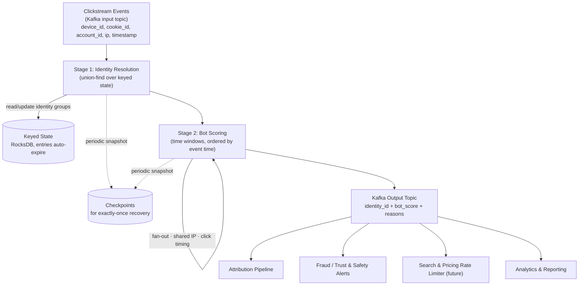

# Real-Time Identity Resolution & Bot Detection — Architecture & Data Model

## The One-Paragraph Version

A Flink job reads clickstream events from Kafka. The first stage groups device, cookie, and account IDs that appear together into one identity. The second stage looks at each identity over a time window and scores how bot-like it behaves. The result goes back out to Kafka for other teams. The whole thing is built so that if a machine dies mid-stream, we don't lose or double-count anything.

> The design choices below (how we partition the data, exact field names, window sizes) are written as decisions to confirm against the running job — flag anything that doesn't match what was actually built.

## Key Terms

| Term | What it means |
|---|---|
| Flink | The stream processing engine this job runs on. Processes events one at a time as they arrive, rather than in nightly batches. |
| Kafka | The message queue events flow through — one topic in, one topic out. |
| Operator | One processing step inside the Flink job. Our job has two main ones: identity resolution, then bot scoring. |
| Keyed state | Memory the job keeps per key — here, per identity. When an event for identity X arrives, Flink gives the operator exactly X's stored data to read and update. |
| RocksDB | An on-disk key-value store Flink can use to hold that state, so it can be larger than available memory. |
| TaskManager | A Flink worker process. A job runs across several; killing one is how we test failure recovery. |
| Checkpoint | A periodic saved snapshot of everything the job has in state. On a crash, the job restarts from the last one. |
| Exactly-once | The guarantee that each input event affects the output exactly one time, even across a crash and restart. Not "at least once" (duplicates) and not "at most once" (data loss). |
| Event time | Ordering by when something actually happened, not when it reached us. |
| Watermark | A marker flowing through the stream meaning "we believe we've now seen all events up to time T." It's how the job decides a time window is complete and safe to emit. |
| Union-find | An algorithm for merging groups. Each group has one member designated as its representative; merging two groups means pointing one representative at the other. Checking "are these two IDs in the same group?" means following the pointers up to the representative for each. |
| Fan-out | How many distinct IDs have merged into one identity. The core bot signal — a bot farm accumulates far more than a real person. |

## Architecture

## How It Works, Step by Step

**Stage 1 — Identity Resolution.** Runs on every single event.

An event might carry a device ID, a cookie ID, and sometimes an account ID. The fact that they arrived on the *same event* is the evidence that they belong to the same person. So the operator looks up what group each of those IDs currently belongs to, and if they're in different groups, it merges them into one. Then it tags the event with the identity it now belongs to and passes it along.

The merging is permanent and incremental — we never recompute the whole graph, we just keep absorbing new evidence as it arrives. That's what makes it work in real time.

**Stage 2 — Bot Scoring.** Runs on time windows, not individual events.

Scoring needs to look at behavior over a period, not one click, so this stage collects events per identity over a window and then computes three things:

- **Fan-out** — how many new device and cookie IDs joined this identity during the window. A real traveler adds devices rarely. A bot farm adds them constantly.
- **Shared IP address** — how many *separate* identities were seen on the same IP address. Note this one is computed per IP address rather than per identity, then attached back to each identity that used that address. That's deliberate: it catches bot farms whose fake identities haven't been merged together yet, because they were careful not to let their IDs co-occur on a single event.
- **Click timing** — the gaps between consecutive events. Humans are irregular; they pause, they get distracted. Scripts produce intervals that are either too fast to be physically possible or suspiciously evenly spaced.

These combine into one score, published along with the individual signal values so each consuming team can set its own threshold instead of trusting our blended number.

**Why event time and watermarks matter here.** The three signals don't arrive together or in order. Account ID in particular usually shows up at checkout — long after the device and cookie events from the same session. If we scored by arrival time, we'd finalize a window before the evidence that changes the answer had arrived. Processing by event time with watermarks lets the job wait an appropriate amount before declaring a window complete.

## Components

| Component | What it does |
|---|---|
| **Kafka input topic** | Raw clickstream events: device ID, cookie ID, account ID (empty until someone logs in), IP address, event type, and when it happened |
| **Identity Resolution operator** | Merges IDs that appear together into one identity; tags each event with its current identity |
| **Keyed state (RocksDB)** | Holds the identity groups. RocksDB rather than memory because at production traffic the graph is bigger than the job's available memory |
| **Automatic expiration** | Any link not seen again within a set time window is dropped, so one-off and long-dormant visitors don't pile up forever |
| **Bot Scoring operator** | Computes the three signals over time windows and combines them into a score |
| **Checkpointing** | Periodically snapshots all state; combined with Kafka's transactional writes, this is what makes the exactly-once guarantee hold through a crash |
| **Kafka output topic** | Identity ID, bot score, the individual signal values, and the original event's reference fields |
| **Downstream consumers** | Attribution (drop or flag bot clicks), fraud team (alerts), platform team (rate limiting, future), analytics and reporting |

## Data Model

### Identity group state (one per identity)

| Field | Type | Notes |
|---|---|---|
| `cluster_root_id` | string | The ID chosen to represent this group — how union-find identifies the group |
| `member_ids` | set of strings | Every device, cookie, and account ID merged into this identity |
| `last_seen_at` | timestamp | Refreshed on every event; this is what the expiration clock reads |
| `first_seen_at` | timestamp | Used to measure how fast the identity grew |

### Bot scoring window state (one per identity, per window)

| Field | Type | Notes |
|---|---|---|
| `distinct_member_count_in_window` | int | The fan-out signal — how many new IDs joined during this window |
| `distinct_identities_per_ip` | int | The shared-IP-address signal — computed per address, then attached to each identity on it |
| `inter_arrival_stats` | average, standard deviation, minimum | The click-timing signal. Low standard deviation means mechanically even spacing; a very low minimum means faster than a human could click |
| `bot_score` | float | The three signals combined |

### Output record

| Field | Type | Notes |
|---|---|---|
| `event_id` | string | Links back to the original event |
| `identity_id` | string | The identity as of right now — this can change later if the group merges again (see below) |
| `bot_score` | float | A 0–1 likelihood, not a yes/no verdict |
| `signal_breakdown` | fan-out, shared IP, timing | The individual values behind the score, so consumers can apply their own thresholds |
| `watermark_at_emission` | timestamp | Tells a consumer how much late data could still arrive and change this score |

## How Failure Is Handled

- **State lives in RocksDB**, on disk, so the identity graph isn't limited by memory. Checkpoints are incremental — each one saves only what changed, not a full copy.
- **Exactly-once comes from two things working together**: Flink's checkpoints (a consistent snapshot of all state at a moment in time) and Kafka's transactional writes (output stays invisible to consumers until the checkpoint that produced it is confirmed). Without the second half, a crash between writing output and saving the checkpoint would produce duplicates on replay.
- **State stays bounded** because unused links expire, so storage tracks active traffic rather than all traffic ever seen.
- **This was tested, not assumed.** We killed TaskManagers while data was flowing and confirmed the output topic had no duplicated and no missing records afterward — the guarantee holds under a real crash, not just on paper.

## Known Trade-offs & Open Items

- **Merging across partitions is the hard part.** Flink splits state across workers by key. If device IDs and account IDs get routed to different workers, then discovering that two *already-existing* groups on *different workers* should merge is not something one worker can do alone — it needs either a broadcast of recent state or an explicit merge message sent to both. Worth confirming how the running job handles this, because if groups can silently exist in two places, the fan-out count is wrong.

- **The identity ID isn't stable forever.** We emit the identity as it stands at that moment. Later evidence can merge that group into a bigger one — for example, a returning visitor's old cookie finally links to their account at checkout, long after earlier events were already scored and published under a different ID. Any consumer that needs a stable key over time (attribution reconciliation especially) needs a way to remap old IDs, not just the one we gave them at the time.

- **Expiration conflicts with genuinely infrequent visitors.** Someone who returns after their links have expired looks like a brand-new identity. That's fine for storage, but it means a legitimate once-a-year traveler reappears as a "new" identity rapidly picking up devices — which is the fan-out pattern we treat as a bot signal. Needs validating against real low-frequency users so expiration doesn't manufacture false positives.

- **Click timing is weak on its own.** Someone with saved payment details and autofill clicks through fast and regularly. So does a travel agent doing this all day. That's exactly why it's one of three signals rather than a standalone rule — but how much weight each signal gets has to be tuned on real traffic, not guessed up front.

- **Account ID usually arrives late.** Because it only appears at login or checkout, we may publish a score before the single most informative signal has arrived. Watermark lag needs monitoring, and consumers acting on a score should know how settled it is — the `watermark_at_emission` field exists for exactly that.
