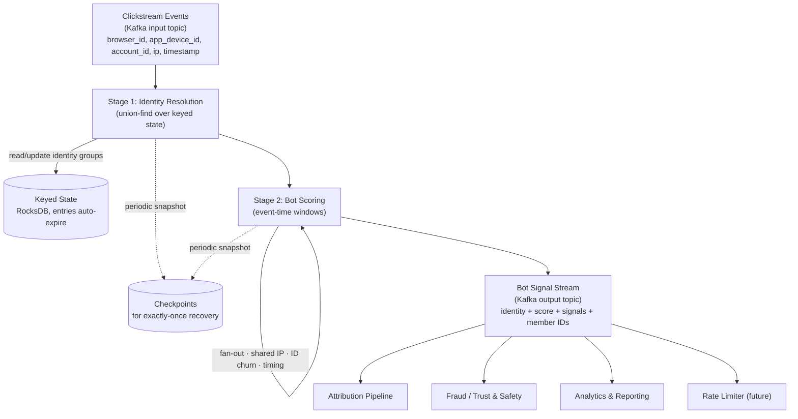

# Real-Time Identity Resolution & Bot Detection — Architecture & Data Model

## The One-Paragraph Version

A Flink job reads clickstream events from Kafka. Stage one groups identifiers that appear together into a single identity. Stage two looks at each identity over a time window and scores how bot-like it behaves. Identities that look automated are published back to Kafka as a bot signal stream for other teams to consume. The whole thing is built so that if a machine dies mid-stream, nothing is lost or double-counted.

## Key Terms

| Term | What it means |
|---|---|
| Flink | The stream processing engine this runs on. Handles events as they arrive rather than in nightly batches. |
| Kafka | The message queue events flow through — topics in, topics out. |
| Operator | One processing step inside the job. Ours has two: identity resolution, then bot scoring. |
| Keyed state | Memory the job keeps per key — here, per identity. When an event for identity X arrives, Flink hands the operator exactly X's stored data to read and update. |
| RocksDB | An on-disk key-value store Flink can use for that state, so it can exceed available memory. |
| TaskManager | A Flink worker process. A job spans several; killing one is how we test recovery. |
| Checkpoint | A periodic snapshot of all job state. After a crash, the job restarts from the last one. |
| Exactly-once | Each input event affects the output exactly one time, even across a crash. Not "at least once" (duplicates), not "at most once" (loss). |
| Event time | Ordering by when something happened, not when it reached us. |
| Watermark | A marker flowing through the stream meaning "we believe we've seen everything up to time T." It tells the job when a window is complete and safe to emit. |
| Union-find | An algorithm for merging groups. Each group has one member designated its representative; merging points one representative at the other. Asking "are these two in the same group?" means following pointers up to each one's representative. |

## The Identifiers We Work With

This drives every design decision downstream, so it comes first.

| Identifier | Backed by | Scope | Survives a browser-data clear? |
|---|---|---|---|
| **Browser ID** | A long-lived cookie, typically years, often stored redundantly across paired cookies so a partial clear regenerates it | One browser | Only partially — a deliberate full clear resets it |
| **App device ID** | Operating-system device identifier, no cookies involved | One device, **app traffic only** | Yes, entirely unaffected |
| **Account ID** | Login | One person | Yes |

**The critical point: on web there is no hardware identifier.** Clickstream schemas commonly label the long-lived browser cookie a "device ID," but it identifies a browser, not a machine. Two browsers on one laptop yield two of them. This means on web, "browser ID" and "device ID" are *one signal, not two* — and treating them as independent corroboration would be double-counting.

### What this implies

**Only these merges carry information:**

| Merge edge | Fires on | Value |
|---|---|---|
| Browser ID ↔ account ID | Web login | The only way to join two browsers to one person |
| App device ID ↔ account ID | App login | Joins app activity to the person |
| **App device ID ↔ browser ID** | **App webview — both on one event** | Bridges app and web identity. The highest-value edge we get. |

**IP address is deliberately not a merge key** — see Example C.

## Architecture



## How It Works, Step by Step

### Stage 1 — Identity Resolution (runs on every event)

An event may carry a browser ID, sometimes an app device ID, sometimes an account ID. The fact that they arrived on the *same event* is the evidence they belong to one person. The operator looks up which group each currently belongs to; if they're in different groups, it merges them. Then it tags the event with the resulting identity and passes it on.

Merging is permanent and incremental — we never recompute the graph, we absorb evidence as it arrives. That's what makes it real-time.

#### Why union-find is built here rather than taken from a library

The algorithm itself is about fifteen lines. No library helps, because every library version holds the whole structure in one process's memory and reads any part of it on demand — and neither of those holds here.

The groups are **split across workers**, and a worker can only read the one key it is currently handling. It cannot follow a pointer into a group living on another machine. And anything kept in plain memory is **gone when a worker restarts**, taking the identity graph with it — a library version would pass a single-node test and then lose everything on the first recovery.

So each identifier keeps its own small piece of state: who it points at, the member list if it happens to be its group's representative, and when it was last seen.

Merging two identifiers on different workers is therefore a **message, not a function call**. One side sends its representative to the other; the receiving side picks the winner — always the lexicographically smaller, so a replay produces the same answer — and the losing group's members are told to re-point. Attaching the smaller group to the larger keeps the number of those re-point messages down.

Because the DataStream API can't loop back on itself, merge messages travel out to a Kafka topic and back in.

### Stage 2 — Bot Scoring (runs on time windows)

Scoring needs behaviour over a period, not a single click, so this stage accumulates events per identity over a window, then computes:

- **Fan-out** — how many new identifiers joined this identity during the window. Strong on app traffic. **Weak on web**, for reasons Example B makes concrete.
- **Shared IP address** — how many *separate* identities appeared on one IP address. Computed per address and then attached back to each identity that used it. Deliberate: it catches bot farms whose identities never merged, because they never let identifiers co-occur on a single event.
- **New-identifier churn per IP address** — how many brand-new browser IDs first appear from one address per minute. This is the counter to cookie-rotating bots and the main thing that still works when fan-out fails.
- **Click timing** — gaps between consecutive events. Humans pause and get distracted; scripts produce intervals either too fast to be physical or suspiciously regular.

These combine into one score, published alongside the individual values so each team can set its own threshold rather than trusting our blend.

**Why event time and watermarks matter here.** The signals don't arrive together or in order. Account ID in particular shows up at checkout, long after the browsing events it retroactively explains. Scoring by arrival time would finalize windows before the evidence that changes the answer had landed. Event time plus watermarks lets the job wait appropriately before declaring a window done.

## Worked Examples

### Example A — a real traveler

| Time | Event carries | Groups afterwards |
|---|---|---|
| Mon 9am | `B1` (laptop Chrome) | `{B1}` |
| Mon 8pm | `B2` (phone browser) | `{B1}`, `{B2}` — still two identities |
| Tue 8pm | `B2`, **`A1`** (logs in on phone) | `{B1}`, `{B2, A1}` |
| Wed 9am | `B1`, **`A1`** (logs in on laptop) | **`{B1, B2, A1}`** — merged |

The merge happens Wednesday because `A1` is already in one group while `B1` is in another, and one event touches both. Until then, treating them as two visitors was *correct given the evidence available*. Three identifiers over three days is unremarkable — no bot signal.

### Example B — a cookie-rotating scraper

A bot clearing browser data between requests. With a true device identifier present (app traffic):

```
B10 + DeviceX → {B10, DeviceX}
B11 + DeviceX → {B10, B11, DeviceX}      ← DeviceX anchors everything
B12 + DeviceX → {B10, B11, B12, DeviceX}
... 200 browser IDs in 5 min              → fan-out = 200 → clearly a bot
```

On **web**, where the only durable identifier is itself a cookie:

```
B10 → {B10}
B11 → {B11}      ← nothing ever merges
B12 → {B12}
```

200 separate identities, each with a fan-out of 1. **The fan-out signal reports "perfectly normal" two hundred times.** This is the single most important limitation of the design to understand and be able to state.

What catches it instead: 200 distinct identities on one IP address within 5 minutes, 200 brand-new browser IDs minted from that address in the same window, and mechanically even click spacing. Those three are why the scoring stage doesn't depend on linking having succeeded.

### Example C — why IP address is never a merge key

Two colleagues on one corporate network share an IP but never share a browser, device, or account. They remain separate identities — correct. Had we merged on IP address, we'd fuse an entire office building into one identity with enormous fan-out and flag it as a bot farm. IP address is a **scoring signal only**.

## Components

| Component | What it does |
|---|---|
| **Kafka input topic** | Raw clickstream events: browser ID, app device ID (app traffic only), account ID (after login only), IP address, event type, event timestamp |
| **Identity Resolution operator** | Merges identifiers appearing together; tags each event with its current identity |
| **Keyed state (RocksDB)** | Holds the identity groups. On-disk rather than in-memory because at production volume the graph exceeds the job's available memory |
| **Automatic expiration** | Links not seen again within a set window are dropped, so one-off and dormant visitors don't accumulate forever |
| **Bot Scoring operator** | Computes the four signals over event-time windows and combines them |
| **Checkpointing** | Snapshots all state periodically; combined with Kafka transactional writes, this is what makes exactly-once hold through a crash |
| **Bot signal stream** | One record per identity per scoring window — score, signal breakdown, and the member identifiers — published for any team to consume |

## Data Model

**Internal vs. external matters here:**

| Model | Lives in | Visibility |
|---|---|---|
| Identity group state | Flink keyed state (RocksDB) | **Internal only.** Never leaves the job. Exists so the next event can be merged. Freely changeable. |
| Bot scoring window state | Flink window state | **Internal only.** Scratch space for one window, discarded when it closes. |
| Bot signal record | Kafka output topic | **The public contract.** The only thing other teams ever see, and the only one needing careful versioning. |

### Identity group state (internal — one per identity)

| Field | Type | Notes |
|---|---|---|
| `cluster_root_id` | string | The member chosen to represent this group — how union-find names it |
| `member_ids` | set of strings | Every browser, app device, and account identifier merged into this identity |
| `last_seen_at` | timestamp | Refreshed on every event; the expiration clock reads this |
| `first_seen_at` | timestamp | Used to measure how fast the identity grew |

**How `cluster_root_id` is chosen.** It is **one of the real member identifiers**, not a generated value — standard union-find, where merging two groups makes one group's representative the parent of the other's (normally attaching the smaller group to the larger).

Two consequences worth knowing:

- **It changes over time.** In Example A the identity is `B1` on Monday and may become `A1` on Wednesday. This is the mechanism behind the "identity isn't stable" caveat below.
- **Choose it deterministically for replay safety.** If the representative is picked arbitrarily, a job replaying from a checkpoint could select a different one and emit different identity IDs for identical input — quietly undermining the exactly-once claim. Picking deterministically (for instance, the lexicographically smallest member) makes replay reproduce identical output.

A production-grade alternative is a **synthetic generated identity plus a published alias table**: when one group absorbs another, emit an "old identity → new identity" record so consumers can follow merges. Costs extra state; saves every downstream team from handling it themselves.

### Bot scoring window state (internal — one per identity, per window)

| Field | Type | Notes |
|---|---|---|
| `distinct_member_count_in_window` | int | Fan-out — new identifiers joined this window |
| `distinct_identities_per_ip` | int | Shared-IP signal — computed per address, attached to each identity on it |
| `new_ids_minted_per_ip` | int | Churn signal — brand-new browser IDs first seen from this address this window |
| `inter_arrival_stats` | mean, standard deviation, minimum | Timing signal. Low standard deviation means mechanical spacing; a very low minimum means faster than a human can click |
| `bot_score` | float | The four signals combined |

### Bot signal record (public — one per identity, per scoring window)

| Field | Type | Notes |
|---|---|---|
| `identity_id` | string | The group representative **at emission time** — may change later if the group merges again |
| `member_ids` | set of strings | The browser, app device, and account identifiers in this identity. **This is what makes the stream usable without a heavy join** — consumers filter their own data against this set |
| `ip_addresses` | set of strings | Addresses this identity was seen on during the window |
| `bot_score` | float | 0–1 likelihood, not a yes/no verdict |
| `signal_breakdown` | fan-out, shared IP, churn, timing | The individual values, so consumers apply their own thresholds rather than trusting our blend |
| `window_start` / `window_end` | timestamp | The period this score describes |
| `watermark_at_emission` | timestamp | Tells a consumer how much late data could still revise this |

**One record per identity per window, not per event.** Scoring is windowed, so per-event output would mean repeating the same score across every event in the window. Per-identity-per-window output is far smaller and loses nothing.

**Emit above a low floor, not everything.** Publishing a record for every identity would mean publishing mostly uninteresting traffic. Emitting only identities scoring above a low threshold keeps volume proportional to suspicious activity rather than total traffic. The floor should sit *below* any threshold a consumer would actually act on, so teams can still choose to be more cautious than us — it exists to drop the obviously-fine, not to make the decision for anyone.

## How Downstream Teams Actually Consume This

We publish one thing: a stream of identities that look automated, with the identifiers belonging to each. What any team does with it is theirs to decide.

**The timing reality matters, though:** the score necessarily lags the event, because scoring needs a window to close. **No consumer can synchronously filter the event that produced the signal.** You either filter *subsequent* traffic or filter *retroactively*. There is no third option — and that's fine, because it covers both real use cases:

- **Retroactive (attribution, analytics).** These reconcile hours or days later anyway, so lag is irrelevant. They take the flagged `member_ids` and exclude matching events from their own data.
- **Forward-looking (fraud alerting, rate limiting).** These can't un-serve the request that triggered the score, and don't need to — they act on the *next* requests from those identifiers.

**Why `member_ids` is on the record.** Without it, every consumer would have to maintain a stateful join back to raw clickstream to work out which events belonged to a flagged identity — the same cost paid four times, with four chances to get it wrong. Shipping the identifier set makes the stream self-contained: a consumer joins a small set of flagged IDs against its own data, which is cheap, instead of joining against the firehose.

## Measuring Success

The three product metrics each need a concrete implementation, or they stay aspirational. All three run as scheduled batch jobs over the warehouse, not inside the streaming job — they're analytical questions over a period, and keeping them out of the hot path means a metric change never risks the pipeline.

**Prerequisite:** the bot signal stream is sunk from Kafka into a warehouse table partitioned by date. Every metric below is SQL over that table joined to existing clickstream and campaign data. No new collection.

### Metric 1 — Booking rate of flagged traffic (precision)

| | |
|---|---|
| **Question** | Are we flagging people who actually book? |
| **Inputs** | `member_ids` from the signal table; booking events from clickstream |
| **How** | For the day's flagged identities, unnest `member_ids` and left-join to booking events on the same identifiers over the same window. Compute bookings-per-identifier for the flagged set, and the same figure site-wide as a baseline. Report the ratio. |
| **Reads as** | Flagged-cohort booking rate ÷ baseline booking rate. Near zero is healthy; approaching 1.0 means we're flagging customers. |
| **Watch out** | It never reaches exactly zero — some bot activity is card-testing and fraudulent booking, which does convert. A *rise* in this ratio is the alarm, not its absolute value. |

### Metric 2 — Recall against datacenter traffic

| | |
|---|---|
| **Question** | Of traffic that is almost certainly automated, how much do we catch? |
| **Inputs** | A reference table of cloud-provider network ranges, refreshed on a schedule from published provider ranges; the signal table |
| **How** | Label clickstream events whose IP address falls in those ranges. Group to identities. Compute the share of those identities that the pipeline independently flagged above threshold. |
| **Reads as** | A percentage. Below target means our thresholds are too conservative or a signal has regressed. |
| **Why it stays honest** | **No scoring signal uses network ownership.** Fan-out, shared IP, churn, and timing are all behavioural. Keep it that way — the moment datacenter membership becomes a scoring input, this metric starts grading its own homework and must be retired. |
| **Watch out** | Residential-proxy bots never appear here, so this is recall on the easy subset. Report it labelled as such. |

### Metric 3 — Business impact

| | |
|---|---|
| **Question** | How much money and load does bot traffic account for? |
| **Inputs** | Signal table; paid-click events with campaign cost; search and pricing request logs |
| **How** | Join flagged `member_ids` to paid clicks, sum the associated spend, break out by campaign. Separately, compute the share of search and pricing requests attributable to flagged identities, broken out by endpoint. |
| **Reads as** | A monthly dollar figure for marketing and a percentage-of-load figure for the platform team. |
| **Watch out** | This is an estimate bounded by metric 2 — we can only count the bots we caught, so it understates the real total. Present it as a floor. |

## Diagnostics & Guardrails

Not product metrics — these exist to explain *why* the three metrics above moved, and to catch the pipeline breaking silently.

| Guardrail | How it's measured | Why it matters |
|---|---|---|
| **False-merge rate** | Share of identity clusters containing more than one distinct account ID | The main cause of metric 1 degrading. Two accounts in one cluster usually means two people were merged — which inflates fan-out and can manufacture a bot flag. (Shared household accounts create some legitimate noise here, so track the trend rather than the absolute.) |
| **Account linkage coverage** | Share of web sessions that ever link to an account | Tells us how much identity resolution is even possible on web. If this is low, the behavioural signals are carrying nearly all the weight, and metric 2 should be read with that in mind. |
| **End-to-end latency** | Event timestamp → signal record published, at p50 and p99 | The signal has to arrive before a consumer can use it. Watermark lag is the usual cause of regression here. |
| **State size per worker** | RocksDB size over time, from Flink metrics | Should be flat once traffic stabilises. Sustained growth means expiry isn't working and the job will eventually fail. |
| **Exactly-once validation** | Chaos test, run before each release — see below | Correctness under failure is a claim that needs re-proving when the job changes. |

### Exactly-once validation procedure

Run against a staging job with a known, replayable input set:

1. Publish a fixed, counted set of events to the input topic.
2. While the job is consuming, kill a TaskManager process.
3. Let the job recover from its last checkpoint and drain.
4. Compare output to expectation on two counts: **no duplicates** (group the output by identity and window, assert one record each) and **nothing lost** (every input identity that should have scored is present).

Both assertions must pass. A duplicate means the Kafka sink isn't transactional; a gap means output was emitted but not covered by a checkpoint.

## How Failure Is Handled

- **State lives in RocksDB** on disk, so the identity graph isn't bounded by memory. Checkpoints are incremental — each saves only what changed.
- **Exactly-once comes from two mechanisms together**: Flink checkpoints (a consistent point-in-time snapshot of all state) and Kafka transactional writes (output stays invisible until the checkpoint that produced it is confirmed). Without the second, a crash between emitting output and saving the checkpoint would produce duplicates on replay.
- **State stays bounded** because unused links expire, so storage tracks active traffic rather than all traffic ever seen.
- **This was tested, not assumed.** TaskManagers were killed while data flowed, and the output topic was verified afterwards to contain no duplicated and no missing records — the guarantee holds under a genuine crash, not just on paper.

## Known Trade-offs & Open Items

- **Fan-out is weak on web, by construction.** Because the durable web identifier is itself cookie-backed, a bot clearing browser data between requests never merges into a cluster, and fan-out reads as normal (Example B). The shared-IP and churn-per-IP signals exist specifically to cover this. Worth stating plainly rather than letting fan-out appear to do more work than it can.

- **Merges across workers resolve asynchronously.** Flink partitions state by key, so each identifier's group membership lives on exactly one worker. When an event links two identifiers that hash to different workers, no single worker can perform the merge alone — the job emits an explicit merge message to each side and the groups converge over one or more hops. The consequence is that merging is eventually consistent: for a brief period after the linking event, one logical identity can still appear as two separate groups, which slightly understates fan-out during that window. Acceptable because fan-out is measured over windows much longer than convergence takes, but it's the reason fan-out is a scoring input rather than a hard rule.

- **The identity ID isn't stable forever.** We emit the representative as it stands. Later evidence can merge that group into a larger one — a returning visitor's browser finally linking to their account at checkout, long after earlier events were scored under a different ID. Consumers needing a stable key over time (attribution reconciliation especially) need either the alias table described above or a remap step.

- **Two different expiry clocks, often confused.** The browser identifier itself lives for years in the browser; our Flink state may expire a link after weeks. A visitor returning after our state expired still presents the *same* browser ID, so re-linking is cheap and fast — this makes the returning-visitor concern much milder than it first appears. The risk isn't losing the identifier, it's losing the *account association* we'd previously established, which then has to be re-earned at the next login.

- **Click timing is weak alone.** Someone with saved payment details and autofill clicks fast and regularly; so does a travel agent working all day. That's exactly why it's one of four signals rather than a standalone rule — but the weighting has to be tuned on real traffic, not guessed up front.

- **Account ID arrives late.** It only appears at login or checkout, so we often publish a score before the most informative signal has landed. Watermark lag needs monitoring, and consumers acting on a score should know how settled it is — `watermark_at_emission` exists for exactly that.
