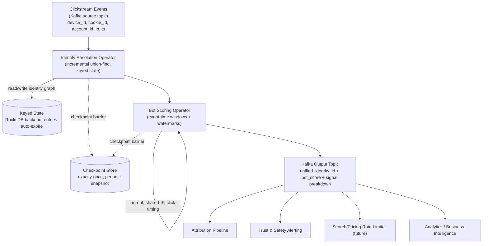

# Real-Time Identity Resolution & Bot Detection — Architecture & Data Model

## Key Terms

Terms below are spelled out in full everywhere they're used in this document — this table is just a quick reference.

| Term | What it means |
|---|---|
| IP address | The network address a device connects from |
| Java Virtual Machine heap | The in-memory space Flink's own process runs in — a limited resource, separate from RocksDB's on-disk state |
| Time-based expiration | Automatically discarding a stored entry once it's gone unused for a set amount of time, so storage doesn't grow forever |
| Business-intelligence reporting | Analytics/dashboard tooling used to visualize data for business decisions |

Stateful Flink job over Kafka that links device/cookie/account signals into unified identities via incremental union-find, then scores each identity cluster for bot-likelihood using event-time windowed signals. Built for exactly-once correctness under failure (RocksDB state, checkpointing), with state that automatically expires so the identity graph doesn't grow unbounded.

> Design assumptions below (keying strategy, exact schemas, window sizes) are documented as implementation decisions to confirm against the actual job — flag anything that doesn't match what was actually built.

## Architecture

## Processing Stages

| Stage | Fires on | Action |
|---|---|---|
| **Identity Resolution** | Every clickstream event | Looks up/updates union-find state for the event's device_id, cookie_id, account_id; merges clusters when two previously-separate IDs co-occur on the same event; emits the event tagged with its current `unified_identity_id` |
| **Bot Scoring** | Windowed, per `unified_identity_id` and per `ip`, event-time with watermarks | Computes fan-out count (distinct device/cookie IDs merged into the cluster within the window), shared-IP-address concentration (distinct identities seen on the same IP address within the window), and click-timing regularity (inter-arrival time stats); combines into a bot_score |

**How the workflow runs**: every event first passes through identity resolution, which may merge its IDs into an existing cluster or create a new one — this always happens before scoring, since bot scoring operates on clusters, not raw IDs. Bot scoring then runs as a windowed aggregation keyed by the resolved identity (and separately by IP address, to catch shared-IP-address fan-out even across identities that haven't been merged). Watermarks account for signals that can arrive out of order across the three underlying sources (e.g. account_id is often only revealed at checkout, well after the device/cookie signals for the same session).

## Components

| Component | Responsibility |
|---|---|
| **Kafka Input Topic** | Raw clickstream events: device_id, cookie_id, account_id (nullable until login/checkout), ip, event_type, event_time |
| **Identity Resolution Operator** | Incremental union-find over keyed state — merges device/cookie/account IDs that co-occur on the same event into one cluster; assigns/propagates `unified_identity_id` |
| **Keyed State (RocksDB)** | Backs the union-find parent map per identity cluster; RocksDB chosen over heap state because the identity graph is expected to exceed what fits comfortably in the Java Virtual Machine heap at production event volume |
| **Automatic expiration** | Bounds identity graph growth — a device/cookie/account edge not reinforced within a set amount of time expires, so long-idle or one-off visitors don't accumulate in state forever |
| **Bot Scoring Operator** | Event-time windowed aggregation computing fan-out, shared-IP concentration, and click-timing regularity per cluster; combines into a single bot_score with a signal breakdown |
| **Checkpointing** | Periodic exactly-once snapshot of all keyed state (RocksDB incremental checkpoints) plus Kafka transactional output, so a TaskManager failure replays from the last checkpoint without duplicating or dropping output |
| **Kafka Output Topic** | One row per event (or per window close): `unified_identity_id`, `bot_score`, signal breakdown, and the original event's correlation fields |
| **Downstream consumers** | Attribution pipeline (exclude/flag bot-attributed conversions), trust & safety (alert on high fan-out clusters), search/pricing platform (capacity/rate-limit input, future), analytics and business-intelligence reporting |

## Data Model

### Identity Graph State (keyed, per cluster)

| Field | Type | Notes |
|---|---|---|
| `cluster_root_id` | string | Union-find root/representative ID for the cluster |
| `member_ids` | set\<string\> | All device_id/cookie_id/account_id values merged into this cluster |
| `last_seen_at` | timestamp | Drives when this entry expires — refreshed on every event that touches this cluster |
| `first_seen_at` | timestamp | Used for fan-out-within-window calculations |

### Bot Scoring Window State (per `unified_identity_id`, per window)

| Field | Type | Notes |
|---|---|---|
| `distinct_member_count_in_window` | int | Fan-out signal — how many new IDs merged into the cluster within the window |
| `distinct_identities_per_ip` | int | Shared-IP-address signal — computed per IP address, not per identity, then joined back onto any identity touching that IP address |
| `inter_arrival_stats` | struct (mean, stddev, min) | Click-timing signal — unusually low variance or sub-human intervals skew toward "likely bot" |
| `bot_score` | float | Combined score from the three signals above |

### Output Event

| Field | Type | Notes |
|---|---|---|
| `event_id` | string | Original event's correlation ID |
| `unified_identity_id` | string | Cluster root ID at time of emission — can change later if the cluster merges further (see Notes) |
| `bot_score` | float | 0–1 likelihood, not a binary decision |
| `signal_breakdown` | struct | Per-signal contribution (fan_out, shared_ip, timing_regularity), so downstream consumers can apply their own thresholds rather than trusting one blended number |
| `watermark_at_emission` | timestamp | Lets consumers reason about how much late data could still change this score |

## Fault Tolerance

- **State backend**: RocksDB, enabling state larger than available heap and incremental checkpointing (only state deltas are checkpointed, not a full snapshot every time).
- **Exactly-once**: Flink's checkpointing (consistent snapshot of all operator state) combined with Kafka's transactional/two-phase-commit sink — output is only visible to consumers once the checkpoint that produced it is confirmed complete.
- **Automatically-expiring state**: identity graph entries expire without reinforcement, keeping state size proportional to active traffic rather than all-time traffic.
- **Validated recovery**: chaos-tested by killing TaskManagers mid-stream and confirming the output topic has no duplicate and no missing records after recovery — i.e. the exactly-once guarantee holds under a real failure, not just in theory.

## Notes / Future Work

- **Cross-partition merges are the hard part of distributed union-find.** If `device_id`, `cookie_id`, and `account_id` route to different state partitions depending on which key the job partitions by, detecting that two *already-separate* clusters on different partitions should merge (e.g. an account_id later appears alongside a device_id that's already linked to a different cluster elsewhere) requires either broadcasting small/recent state, or an explicit merge-request message routed to both partitions. Confirm which approach the actual job uses — this materially affects correctness of the fan-out signal if clusters can silently exist in two places at once.
- **`unified_identity_id` is not immutable.** A cluster can merge further after its ID has already been emitted downstream (e.g. a returning visitor's old cookie finally links to their account at checkout, well after earlier events were scored and emitted under a different cluster ID). Downstream consumers that need a stable key across time (e.g. attribution reconciliation) need a reconciliation/remap path, not just a point-in-time cluster ID.
- **Expiration vs. returning-visitor identity.** A visitor who returns after their old entry has already expired is treated as a brand-new identity — this bounds state size but means long-gap returning visitors can spuriously look like a "new" cluster exhibiting fan-out, which is itself one of the bot signals. Worth validating that legitimate low-frequency visitors aren't getting swept into the fan-out signal purely from expiring and re-linking.
- **Click-timing is a noisy signal in isolation.** Humans using autofill/saved payment or power users (travel agents) can also produce fast, regular intervals — this is why it's combined with fan-out and shared-IP-address concentration rather than used alone, but the combination weighting needs real-traffic tuning, not a fixed formula guessed up front.
- **Late-arriving account_id.** Because account_id is often only revealed at login/checkout, a bot score may be emitted before that signal arrives and later look different once it does — watermark lag should be monitored, and consumers that act on bot_score (e.g. excluding attribution) should know how final a given score is at the time they consume it.
